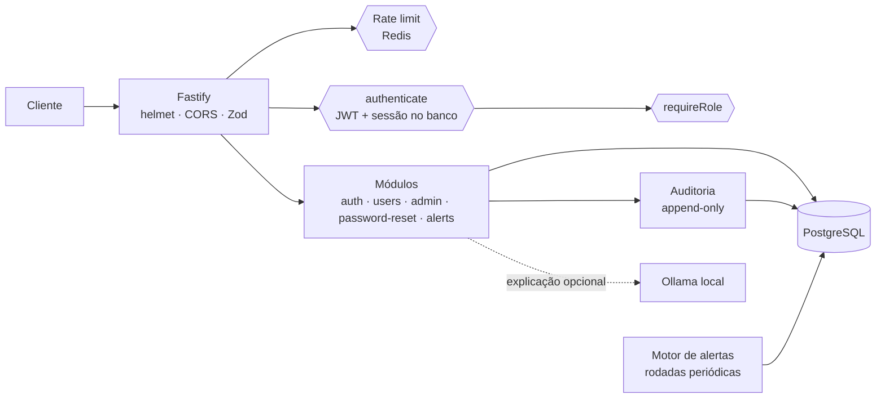
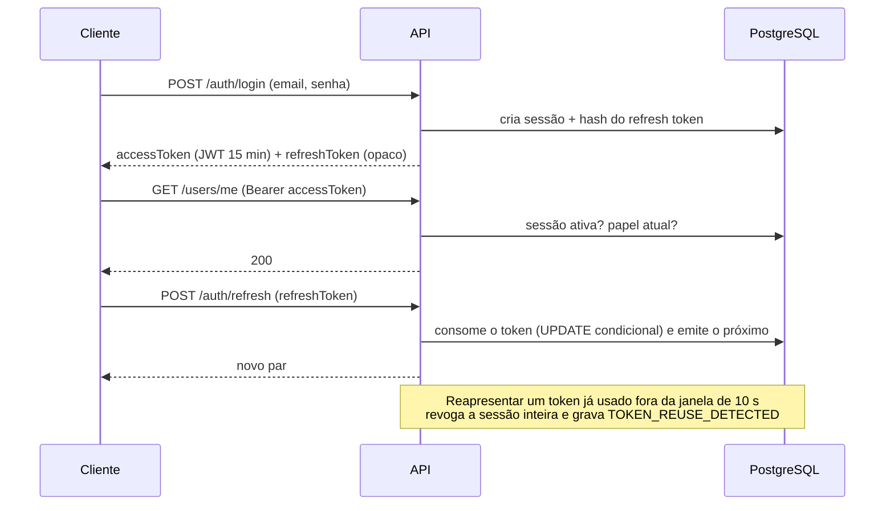

# AuthAPI Pro

API REST de autenticação e gestão de usuários com foco em segurança: JWT com rotação de refresh
tokens, RBAC, rate limiting distribuído no Redis, recuperação de senha resistente a enumeração,
trilha de auditoria append-only e um motor de detecção de ameaças com explicação opcional por IA
local.

Construída com **Node.js 24, TypeScript (strict), Fastify 5, PostgreSQL, Prisma 7 e Redis**.

> Projeto de portfólio. Os números citados aqui (testes, tempos) foram medidos neste repositório;
> o workflow de CI está em [`.github/workflows/ci.yml`](.github/workflows/ci.yml), mas ainda não
> foi executado no GitHub.

---

## Sumário

1. [O problema](#o-problema)
2. [Funcionalidades](#funcionalidades)
3. [Stack](#stack)
4. [Arquitetura](#arquitetura)
5. [Fluxo de autenticação](#fluxo-de-autenticação)
6. [Segurança](#segurança)
7. [Motor de alertas](#motor-de-alertas)
8. [IA local opcional (Ollama)](#ia-local-opcional-ollama)
9. [Como executar](#como-executar)
10. [Testes](#testes)
11. [Endpoints](#endpoints)
12. [Variáveis de ambiente](#variáveis-de-ambiente)
13. [Estrutura de pastas](#estrutura-de-pastas)
14. [CI/CD](#cicd)
15. [Limitações conhecidas](#limitações-conhecidas)
16. [Próximas evoluções](#próximas-evoluções)

Documentação técnica detalhada: [`docs/architecture.md`](docs/architecture.md) ·
Prontidão para produção: [`docs/production-readiness.md`](docs/production-readiness.md)

---

## O problema

Autenticação parece simples até chegar aos detalhes que costumam virar incidente: tokens que não
podem ser revogados, refresh tokens roubados reutilizados sem ninguém perceber, mensagens de erro
que revelam quais emails existem, rate limit que só funciona numa instância, logs com senhas e
tokens, e nenhuma visibilidade sobre ataques em andamento.

O AuthAPI Pro trata esses pontos de forma explícita e testada, e documenta cada decisão e cada
limitação que permanece.

## Funcionalidades

- **Contas:** cadastro, perfil, troca de email com reautenticação (revoga as demais sessões).
- **Autenticação:** access token JWT (HS256, 15 min) + refresh token opaco com **rotação
  obrigatória** e **detecção de reuso** (reuso fora da janela de tolerância revoga a sessão).
- **Sessões:** validade absoluta, logout, logout de todas as sessões, revogação imediata
  (cada requisição confirma a sessão no banco).
- **Recuperação de senha:** resposta idêntica (status, corpo e tempo) exista ou não a conta;
  token de uso único com 256 bits, só o hash no banco; o reset encerra todas as sessões.
- **RBAC:** papéis `USER` e `ADMIN`, avaliados com o papel **atual** do banco.
- **Rate limiting** no Redis, compartilhado entre instâncias, por IP, conta e usuário, com
  chaves pseudonimizadas por HMAC e comportamento definido para Redis fora do ar.
- **Auditoria append-only** (trigger no PostgreSQL), sem senhas, tokens ou emails em claro, com
  retenção configurável e manual.
- **Motor de alertas:** 6 regras determinísticas sobre a trilha de auditoria, deduplicação,
  tolerância a eventos atrasados, ciclo de vida (OPEN → RESOLVED) e retenção.
- **IA local opcional:** explicação dos alertas por um modelo Ollama local (desligada por padrão,
  nunca decide nada).
- **Operação:** `/health` e `/ready`, logs estruturados com redação, Swagger/OpenAPI gerado dos
  schemas Zod, encerramento gracioso.

## Stack

| Camada        | Tecnologia                                                                    |
| ------------- | ----------------------------------------------------------------------------- |
| Runtime       | Node.js 24 (ESM), TypeScript 6 em modo strict                                 |
| HTTP          | Fastify 5, `@fastify/helmet`, `@fastify/cors`                                 |
| Validação     | Zod 4 (entrada, saída, variáveis de ambiente) via `fastify-type-provider-zod` |
| Banco         | PostgreSQL 18 com Prisma 7 (driver adapter `pg`)                              |
| Cache/limites | Redis 8 (`ioredis`)                                                           |
| Criptografia  | `jose` (JWT), Argon2id nativo do `node:crypto`, SHA-256 e HMAC-SHA256         |
| Documentação  | `@fastify/swagger` + Swagger UI (OpenAPI 3.1)                                 |
| Testes        | Vitest 5 (unitários + integração contra PostgreSQL e Redis reais)             |
| Infra local   | Docker Compose                                                                |
| IA (opcional) | Ollama local com `qwen2.5:7b`                                                 |
| Qualidade     | ESLint (type-checked), Prettier, GitHub Actions                               |

## Arquitetura

Monólito modular em camadas, com injeção de dependências manual num único _composition root_
(`src/app.ts`). Cada módulo tem rotas (HTTP + schemas Zod), service (regras de negócio, sem
Fastify) e repository (Prisma).



- **PostgreSQL** guarda tudo que precisa ser durável e consistente: usuários, sessões, hashes de
  tokens, auditoria, alertas e o checkpoint do motor. Operações críticas são transacionais
  (rotação de refresh token, reset de senha, troca de email, rodadas do motor).
- **Redis** guarda apenas contadores de rate limit (efêmeros, com TTL).
- **Processo em segundo plano:** o motor de alertas roda dentro da API em rodadas periódicas,
  fora do caminho das requisições, ou pelo comando `npm run alerts:process`.

Detalhes, diagramas e trade-offs: [`docs/architecture.md`](docs/architecture.md).

## Fluxo de autenticação



- O access token carrega `sub`, `sid` e `role`, com `iss`/`aud` fixos e algoritmo único (HS256).
- A autorização usa o papel do banco, não o do token: um rebaixamento vale na hora.
- Refresh tokens e tokens de recuperação são opacos (256 bits); o banco guarda só o SHA-256.

## Segurança

| Ameaça                                | Mitigação                                                                                                        |
| ------------------------------------- | ---------------------------------------------------------------------------------------------------------------- |
| Força bruta e credential stuffing     | Rate limit por IP **e** por conta (email normalizado), Argon2id (OWASP: 19 MiB, t=2), alertas                    |
| Enumeração de contas                  | Login com mensagem única e custo igual (hash fictício); recuperação sempre `202`, com o trabalho após a resposta |
| Roubo de refresh token                | Rotação obrigatória, consumo atômico, reuso revoga a família inteira                                             |
| Token roubado após logout/reset       | Toda requisição confirma a sessão no banco; reset e troca de email revogam sessões                               |
| `alg: none` / troca de algoritmo      | Lista fixa (`HS256`), `iss` e `aud` obrigatórios, claims validadas com Zod                                       |
| Escalada de privilégio / IDOR         | Fora de `/admin` nenhuma rota recebe id de usuário; cadastro sempre `USER`; `requireRole` com papel do banco     |
| Vazamento em logs                     | Redação de headers e campos sensíveis, URL sem query string, testes que procuram segredos nos logs               |
| Falsificação de IP (X-Forwarded-For)  | `TRUST_PROXY=true` é recusado; só número de saltos ou lista de proxies                                           |
| Redis fora do ar                      | Rotas sensíveis falham fechadas (`503`); leituras de baixo risco falham abertas                                  |
| Adulteração da auditoria              | Trigger recusa `UPDATE`/`DELETE`; exclusão só pela rotina de retenção                                            |
| Abuso de payload / conexões lentas    | `bodyLimit` de 16 KB, `requestTimeout`, schemas `strictObject`                                                   |
| Exposição de documentação em produção | Swagger desligado por padrão com `NODE_ENV=production`                                                           |

Configuração validada na inicialização: segredos com pelo menos 32 caracteres e diferentes entre
si, CORS sem `*` em produção, link de recuperação obrigatoriamente `https` em produção. Mensagens
de erro citam a variável e a correção, nunca o valor.

## Motor de alertas

Lê a trilha de auditoria e gera alertas persistidos em `security_alerts`. Não bloqueia contas
nem age sobre usuários.

| Regra                  | Dispara quando (padrão configurável)                    | Severidade             |
| ---------------------- | ------------------------------------------------------- | ---------------------- |
| `BRUTE_FORCE_ACCOUNT`  | ≥ 8 falhas de login para a mesma conta em 1 h           | MEDIUM (HIGH com ≥ 16) |
| `CREDENTIAL_STUFFING`  | Um IP falhando em ≥ 5 contas diferentes em 1 h          | HIGH                   |
| `TOKEN_REUSE`          | Refresh token reutilizado fora da janela de tolerância  | HIGH                   |
| `RATE_LIMIT_ABUSE`     | O mesmo IP bloqueado pelo rate limit ≥ 3 vezes em 1 h   | LOW (MEDIUM com ≥ 6)   |
| `ADMIN_ACCESS_PROBING` | Um usuário com ≥ 5 acessos negados a rotas admin em 1 h | MEDIUM (HIGH com ≥ 10) |
| `PASSWORD_RESET_ABUSE` | ≥ 5 pedidos de recuperação do mesmo IP em 1 h           | LOW (MEDIUM com ≥ 10)  |

Garantias principais (todas cobertas por testes de integração):

- **Sem perda de eventos:** checkpoint persistido de `created_at` **e** horizonte de transações
  do PostgreSQL (`xid8`), que encontra eventos que confirmaram atrasados.
- **Sem contagem dupla:** cada evento soma uma única vez (livro-razão `detection_flagged_events`),
  inclusive ao reprocessar um intervalo.
- **Um processador por vez:** advisory lock; rodar a API e o comando manual juntos é seguro.
- **Deduplicação deslizante:** um incidente contínuo é um alerta, até uma duração máxima (7 dias);
  depois abre-se um alerta novo ligado ao anterior.
- **Ciclo de vida:** `PATCH /admin/security-alerts/:id` resolve um alerta (OPEN → RESOLVED);
  não há exclusão por HTTP.

```powershell
npm run alerts:process                        # uma rodada manual (seguro junto com a API)
npm run alerts:retention                      # simulação da retenção (nada é apagado)
```

## IA local opcional (Ollama)

`POST /api/v1/admin/security-alerts/:id/explanation` pede a um modelo **local** uma explicação em
texto do alerta. A IA **não detecta, não decide, não grava e não altera nada**.

- Desligada por padrão (`ALERTS_AI_ENABLED=false` responde `status: "disabled"`).
- `OLLAMA_URL` só aceita `localhost`, `127.0.0.1` ou `::1`.
- Recebe só regra, severidade, números e duração: nunca IP, email, ids ou datas.
- Saída validada com Zod e limitada em tamanho; falhas e timeouts viram `status: "unavailable"`.

```powershell
ollama pull qwen2.5:7b            # feito por você; a API nunca baixa modelos
# no .env: ALERTS_AI_ENABLED=true
```

Medido nesta máquina com `qwen2.5:7b`: ~14 s na primeira chamada (carga do modelo) e ~1,3 s com
o modelo carregado. O modelo às vezes interpreta números de forma imprecisa: a explicação é apoio
à análise humana, nunca evidência.

## Como executar

### Requisitos

- Node.js 24 (`.nvmrc`)
- Docker Desktop (ou Docker Engine com Compose)
- Opcional: Ollama, para as explicações por IA

### Passo a passo (PowerShell; em bash, troque `Copy-Item` por `cp`)

```powershell
npm install                          # dependências + Prisma Client
Copy-Item .env.example .env          # depois preencha JWT_ACCESS_SECRET e RATE_LIMIT_HMAC_SECRET
npm run docker:up                    # PostgreSQL (127.0.0.1:5433) e Redis (127.0.0.1:6379)
npm run db:migrate:deploy            # aplica as migrations no banco de desenvolvimento
npm run db:seed                      # usuários fictícios (opcional)
npm run dev                          # http://127.0.0.1:3000
```

Gere cada segredo (rode duas vezes, um valor para cada variável):

```powershell
node -e "console.log(require('crypto').randomBytes(48).toString('base64url'))"
```

Se faltar alguma configuração, a API não sobe e diz qual variável corrigir e como.

- **Docker Compose:** só publica portas em `127.0.0.1`. O PostgreSQL usa a porta **5433** para não
  conflitar com uma instalação local na 5432. O banco de testes `authapi_test` é criado no
  primeiro `docker:up`.
- **Migrations:** `npm run db:migrate:deploy` aplica as pendentes (o mesmo comando do CI);
  `npm run db:migrate` é para criar migrations novas durante o desenvolvimento.
- **Seed:** cria `ada.admin@example.com`, `bruno.user@example.com` e `carla.user@example.com`, todos
  `USER`, com a senha de `SEED_USER_PASSWORD`. Recusa produção e bancos não locais. Para testar o
  papel ADMIN:

  ```powershell
  npm run admin:promote -- --email ada.admin@example.com --confirm ada.admin@example.com
  ```

- **Swagger:** <http://127.0.0.1:3000/docs> (OpenAPI em `/docs/json`). Use **Authorize** com o
  `accessToken` do login.
- **Saúde:** `/health` (liveness) e `/ready` (PostgreSQL e Redis; `503` se algum cair).

### Produção (build)

```powershell
npm run build
$env:NODE_ENV = "production"; npm start
```

Antes de qualquer implantação, leia [`docs/production-readiness.md`](docs/production-readiness.md).

## Testes

```powershell
npm run docker:up          # a integração usa o PostgreSQL e o Redis do Compose
npm test                   # tudo
npm run test:unit          # só unitários (sem Docker)
npm run test:integration   # só integração (banco authapi_test)
npm run test:coverage      # com cobertura
```

- **677 testes** (40 arquivos), executados nesta máquina com sucesso.
- A integração roda contra PostgreSQL e Redis reais, num banco separado (`authapi_test`), com
  dados fictícios (domínios `example.com`, IPs de faixas reservadas). `prisma migrate deploy` é
  aplicado automaticamente antes da suíte.
- Cobertura de cenários de segurança e resiliência: concorrência (refresh, reset, resolução de
  alertas), reuso de token, Redis e PostgreSQL indisponíveis, reinício do servidor e do motor,
  transação lenta real, eventos atrasados, path traversal, ausência de segredos em logs e
  respostas, falhas e timeouts da IA.

Verificações de qualidade:

```powershell
npm run lint; npm run typecheck; npm run format:check; npm run build; npm audit
```

## Endpoints

| Método | Rota                                            | Acesso  | Descrição                                                  |
| ------ | ----------------------------------------------- | ------- | ---------------------------------------------------------- |
| GET    | `/health`                                       | público | Liveness                                                   |
| GET    | `/ready`                                        | público | Readiness: PostgreSQL e Redis (200 ou 503)                 |
| POST   | `/api/v1/auth/register`                         | público | Cadastro (sempre `USER`)                                   |
| POST   | `/api/v1/auth/login`                            | público | Cria sessão; devolve access token e refresh token          |
| POST   | `/api/v1/auth/refresh`                          | token¹  | Rotação do refresh token                                   |
| POST   | `/api/v1/auth/logout`                           | Bearer  | Encerra a sessão atual                                     |
| POST   | `/api/v1/auth/logout-all`                       | Bearer  | Encerra todas as sessões                                   |
| POST   | `/api/v1/auth/forgot-password`                  | público | Pede o link de recuperação (sempre `202`)                  |
| POST   | `/api/v1/auth/reset-password`                   | token²  | Redefine a senha e encerra todas as sessões                |
| GET    | `/api/v1/users/me`                              | Bearer  | Perfil                                                     |
| PATCH  | `/api/v1/users/me`                              | Bearer  | Nome e/ou email (o email exige `currentPassword`)          |
| GET    | `/api/v1/admin/users`                           | ADMIN   | Usuários: paginação, filtros, ordenação                    |
| GET    | `/api/v1/admin/users/:id`                       | ADMIN   | Um usuário                                                 |
| GET    | `/api/v1/admin/audit-events`                    | ADMIN   | Auditoria: filtros por tipo, usuário e período             |
| GET    | `/api/v1/admin/security-alerts`                 | ADMIN   | Alertas: paginação, filtros por regra, severidade e estado |
| GET    | `/api/v1/admin/security-alerts/:id`             | ADMIN   | Um alerta (+ quais eventos de amostra ainda existem)       |
| PATCH  | `/api/v1/admin/security-alerts/:id`             | ADMIN   | Resolve o alerta (`{"status":"RESOLVED","note":"..."}`)    |
| POST   | `/api/v1/admin/security-alerts/:id/explanation` | ADMIN   | Explicação por IA local (opcional)                         |

¹ A credencial é o refresh token no corpo. ² A credencial é o token de recuperação no corpo.

Todos os erros seguem `{ "error": { "code", "message", "requestId", "details"? } }`. As rotas
admin aplicam, nesta ordem, autenticação (401), rate limit por usuário (429) e papel (403); cada
403 e cada consulta administrativa são auditados.

| Código                            | Status | Quando                                                       |
| --------------------------------- | ------ | ------------------------------------------------------------ |
| `VALIDATION_ERROR`                | 400    | Entrada fora do schema (campos listados em `details`)        |
| `WEAK_PASSWORD`                   | 400    | Senha recusada pela política (motivo em `details.reason`)    |
| `CURRENT_PASSWORD_REQUIRED`       | 400    | Troca de email sem `currentPassword`                         |
| `INVALID_RESET_TOKEN`             | 400    | Link de recuperação inválido, expirado ou já usado           |
| `UNAUTHORIZED`                    | 401    | Header `Authorization: Bearer` ausente ou malformado         |
| `INVALID_TOKEN` / `TOKEN_EXPIRED` | 401    | Access token inválido / vencido (faça refresh)               |
| `INVALID_SESSION`                 | 401    | Sessão encerrada ou expirada                                 |
| `INVALID_CREDENTIALS`             | 401    | Email ou senha inválidos (mesma resposta para os dois casos) |
| `INVALID_REFRESH_TOKEN`           | 401    | Refresh token desconhecido, expirado ou de sessão encerrada  |
| `REFRESH_TOKEN_REUSED`            | 401    | Reuso fora da janela: a sessão foi revogada                  |
| `FORBIDDEN`                       | 403    | Papel sem permissão                                          |
| `INVALID_CURRENT_PASSWORD`        | 403    | Senha atual errada na troca de email                         |
| `NOT_FOUND`                       | 404    | Recurso ou rota inexistente                                  |
| `CONFLICT`                        | 409    | Email já em uso                                              |
| `REFRESH_TOKEN_ALREADY_ROTATED`   | 409    | Token trocado há menos de 10 s: use o par mais recente       |
| `ALERT_ALREADY_RESOLVED`          | 409    | Alerta já resolvido (RESOLVED é terminal)                    |
| `RATE_LIMITED`                    | 429    | Limite excedido: veja `Retry-After`                          |
| `SERVICE_UNAVAILABLE`             | 503    | Rate limit indisponível (Redis fora do ar) em rota sensível  |
| `INTERNAL_ERROR`                  | 500    | Falha inesperada (mensagem genérica; detalhes só no log)     |

## Variáveis de ambiente

Todas estão documentadas, com valores seguros de exemplo, em [`.env.example`](.env.example) (um
teste garante que nenhuma fique de fora). As principais:

| Variável                                               | Padrão                  | Para quê                                                |
| ------------------------------------------------------ | ----------------------- | ------------------------------------------------------- |
| `DATABASE_URL` / `REDIS_URL`                           | —                       | Conexões (obrigatórias)                                 |
| `JWT_ACCESS_SECRET` / `RATE_LIMIT_HMAC_SECRET`         | —                       | Segredos (obrigatórios, ≥ 32 caracteres, diferentes)    |
| `NODE_ENV`                                             | `development`           | Ativa as validações de produção                         |
| `CORS_ORIGINS`                                         | vazio                   | Origens permitidas (sem `*` em produção)                |
| `TRUST_PROXY`                                          | `false`                 | Número de proxies ou lista de IPs/CIDRs                 |
| `SWAGGER_ENABLED`                                      | ligado fora de produção | Documentação em `/docs`                                 |
| `JWT_ACCESS_TTL_SECONDS`                               | `900`                   | Validade do access token                                |
| `REFRESH_TOKEN_TTL_DAYS` / `SESSION_ABSOLUTE_TTL_DAYS` | `7` / `30`              | Validade do refresh token e da sessão                   |
| `RATE_LIMIT_*`                                         | ver `.env.example`      | Políticas `<máximo>/<janela>`                           |
| `MAIL_PROVIDER`                                        | `log`                   | `log` (só metadados) ou `dev-mailbox` (arquivo, só dev) |
| `ALERTS_ENGINE_*`, `ALERT_*`, `ALERTS_*`               | ver `.env.example`      | Motor de alertas, regras, deduplicação e retenção       |
| `ALERTS_AI_ENABLED`, `OLLAMA_*`                        | desligado               | IA local opcional                                       |
| `AUDIT_RETENTION_*`                                    | desligado               | Retenção da auditoria                                   |

## Estrutura de pastas

```
src/
  app.ts              # composition root: plugins, módulos, motor de alertas
  server.ts           # entrada: listen, sinais, encerramento gracioso
  config/env.ts       # validação Zod de todas as variáveis
  infra/              # Prisma, Redis, logger (redação)
  plugins/swagger.ts
  shared/             # erros, error handler, Argon2id, tarefas em segundo plano
  modules/
    auth/             # login, refresh, logout, JWT, middleware authenticate/requireRole
    users/            # cadastro, perfil, política de senhas
    admin/            # consultas administrativas
    password-reset/   # recuperação de senha
    mail/             # provedores de email (log, dev-mailbox)
    rate-limit/       # políticas, store Redis, hooks
    audit/            # gravação e retenção da auditoria
    alerts/           # regras, motor, deduplicação, ciclo de vida, retenção, IA
    health/           # liveness e readiness
prisma/               # schema, migrations, seed
scripts/              # promote-admin, audit-retention, alerts-process, alerts-retention
tests/unit · tests/integration · tests/helpers
docs/                 # architecture.md, production-readiness.md
.github/workflows/    # ci.yml
```

## CI/CD

[`.github/workflows/ci.yml`](.github/workflows/ci.yml) roda em pushes para `main`, em pull requests
e manualmente:

1. **quality:** `npm ci`, Prisma Client, lint, typecheck, formatação, build e testes unitários.
2. **integration:** PostgreSQL 18 e Redis 8 como serviços, `prisma migrate deploy`, verificação de
   que schema e migrations estão em sincronia e testes de integração.
3. **dependencies:** `npm audit --audit-level=high` (bloqueia high/critical; moderate vai para o
   resumo do job) e verificação de assinaturas do registro.

Só valores fictícios, nenhum segredo do repositório e nenhuma dependência do Ollama. Não há
etapa de deploy (CD) de propósito: ver [Próximas evoluções](#próximas-evoluções).

## Limitações conhecidas

- **Cadastro revela se um email já existe** (`409`): trade-off consciente de usabilidade, mitigado
  pelo rate limit; detalhes em `docs/architecture.md`.
- **Sem troca de senha autenticada** (só pelo fluxo de recuperação) e **sem MFA**.
- **Email real não é enviado:** os provedores são `log` e `dev-mailbox`; produção precisa de um
  provedor SMTP/API.
- **Regras de alerta por limiar fixo:** sem correlação entre regras nem baseline por usuário. IPs
  compartilhados (NAT/CGNAT) geram falsos positivos.
- **Eventos que confirmam mais de 24 h atrasados** (configurável) não são reavaliados pelo motor;
  são contados e registrados no log.
- **HS256 com segredo compartilhado:** adequado a um serviço único; para vários consumidores
  verificando tokens, chaves assimétricas (EdDSA/RS256) seriam melhores.
- **Retenções são manuais** (sem agendador embutido).
- O dono do banco pode desabilitar o trigger append-only: a proteção é contra a aplicação, não
  contra um DBA malicioso.

## Próximas evoluções

- Provedor de email real (SMTP/SES) com fila e retentativas.
- MFA (TOTP/WebAuthn) e troca de senha autenticada.
- Métricas (Prometheus/OpenTelemetry) e notificação de alertas HIGH.
- Imagem Docker da aplicação e pipeline de deploy com migrations controladas.
- Chaves assimétricas com rotação (JWKS).
- Agendamento das retenções (cron externo) com relatórios.

## Licença

MIT
