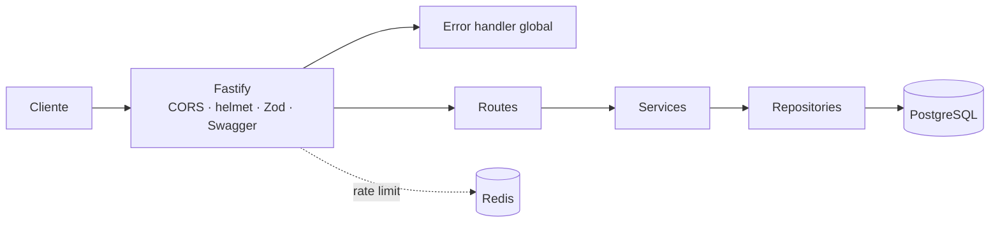
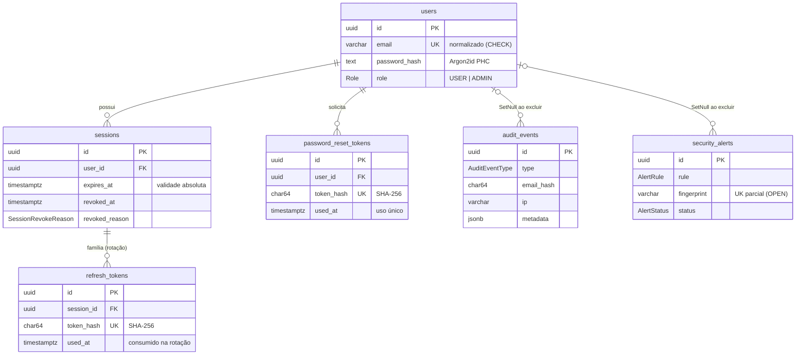
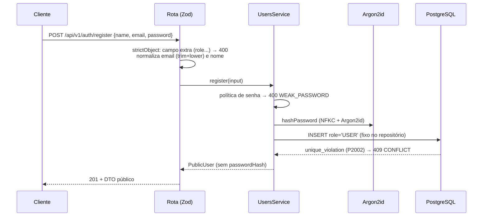
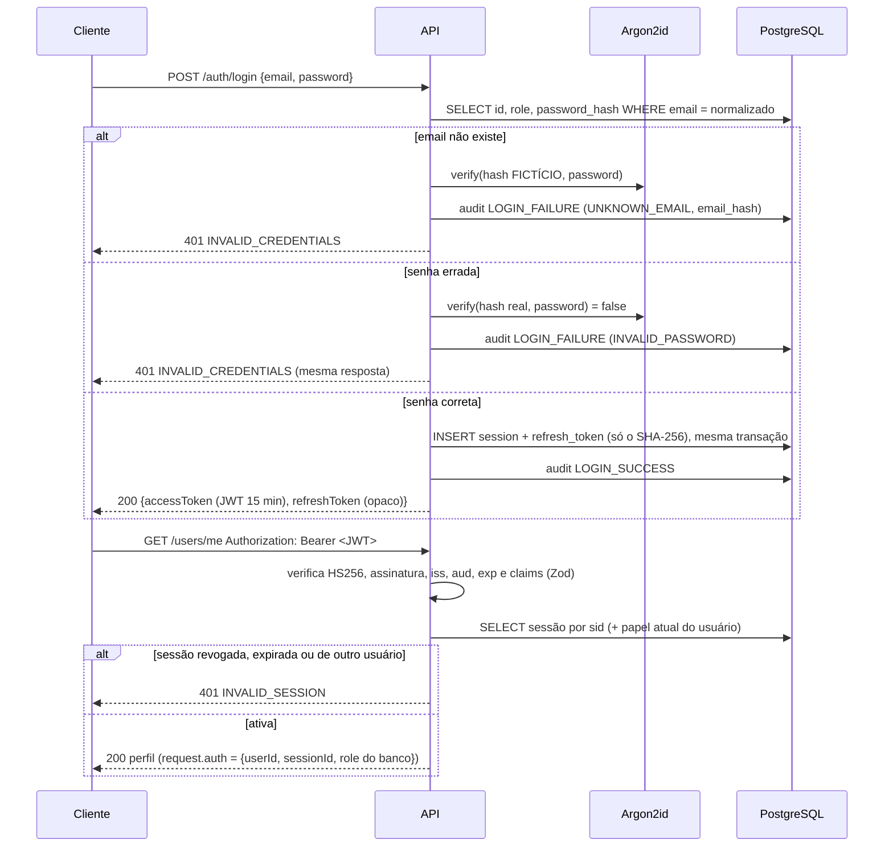
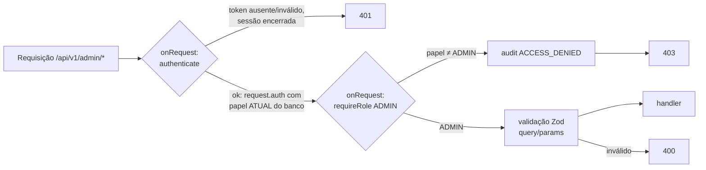
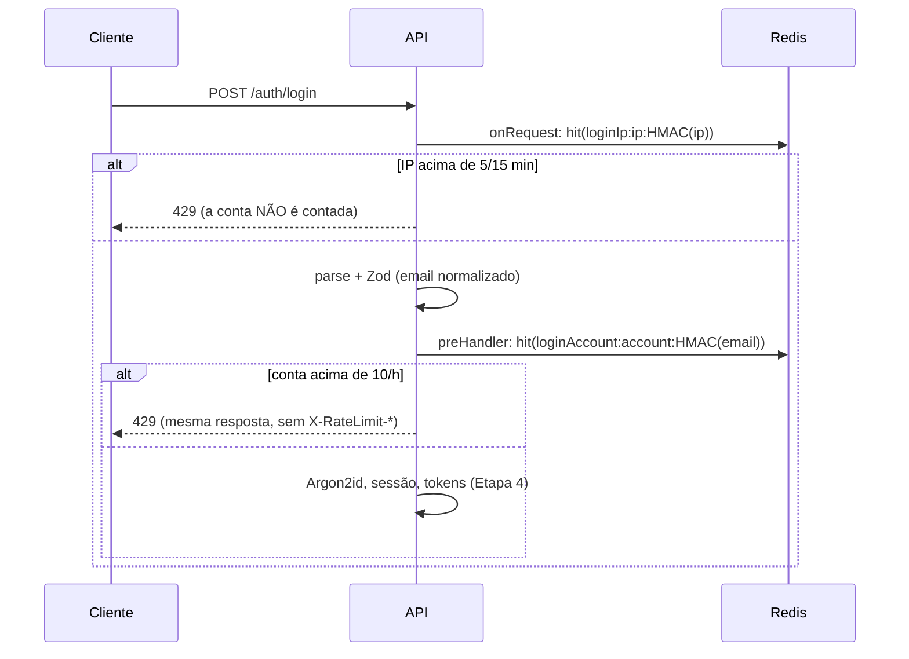

# Arquitetura e decisões técnicas

> Documento vivo: cada etapa acrescenta suas decisões. Status atual: **Etapa 6 (rate limiting com Redis)**.

## Visão geral

Monólito modular em Fastify + TypeScript. Cada módulo de `src/modules/` segue o fluxo
`route → service → repository → Prisma`, e as dependências são montadas manualmente em
`src/app.ts` (composition root), sem container de injeção de dependências.



## Decisões da Etapa 1

| Decisão                                                                   | Motivo                                                                                                             |
| ------------------------------------------------------------------------- | ------------------------------------------------------------------------------------------------------------------ |
| `buildApp({ env })` separado de `server.ts`                               | Os testes criam a aplicação com `app.inject()` sem abrir porta e com env fictício.                                 |
| Env validado com Zod na inicialização                                     | Falha rápido com mensagem clara. A mensagem cita o nome da variável, **nunca o valor**.                            |
| `process.loadEnvFile` nativo (Node ≥ 20.12)                               | Evita a dependência `dotenv`. Variáveis já definidas no ambiente têm precedência.                                  |
| Zod como fonte única de schemas                                           | O mesmo schema valida a entrada, tipa o handler e gera o OpenAPI (`fastify-type-provider-zod`).                    |
| Formato único de erro `{ error: { code, message, requestId, details? } }` | O cliente trata todos os erros do mesmo jeito. O `requestId` liga a resposta ao log.                               |
| Stack trace só em `development`                                           | Em produção, erros 500 retornam mensagem genérica. O detalhe fica apenas no log.                                   |
| Redação no Pino (`authorization`, `cookie`, `password`, `*token`)         | É a segunda barreira: o serializer padrão do Fastify já não registra headers nem body.                             |
| Helmet em contexto encapsulado                                            | A CSP restritiva vale para a API, sem quebrar os assets do Swagger UI em `/docs`.                                  |
| `bodyLimit` de 16 KB                                                      | Payloads de autenticação são pequenos. O limite reduz a superfície de abuso.                                       |
| Request id com `randomUUID()`                                             | É único entre instâncias. O header de entrada não é aceito, para que o cliente não possa forjar ids de correlação. |
| TypeScript 6.0 (não 7.x)                                                  | O `typescript-eslint` 8.72 suporta TypeScript `< 6.1`. Revisar quando houver suporte ao 7.x.                       |

## Decisões da Etapa 2

| Decisão                                                                          | Motivo                                                                                                                                                               |
| -------------------------------------------------------------------------------- | -------------------------------------------------------------------------------------------------------------------------------------------------------------------- |
| Prisma **7.10.1** (não a tag `latest`)                                           | A tag `latest` do npm apontava para `8.0.0-rc.29`, uma release candidate. A 7.10.1 é a estável mais recente.                                                         |
| Driver adapter `@prisma/adapter-pg`                                              | O Prisma 7 executa as queries pelo driver `pg`, sem engine binária de query. Configuração em `src/infra/prisma.ts`.                                                  |
| `prisma.config.ts` carrega o `.env`                                              | O Prisma 7 não carrega `.env` sozinho. A URL do banco fica em `datasource.url` do config, não mais no `schema.prisma`.                                               |
| Client gerado em `src/generated/prisma` (no `.gitignore`)                        | Gerado a partir do schema pelo `postinstall`. Com `moduleFormat = "esm"`, os imports `.js` são compatíveis com `nodenext`.                                           |
| PostgreSQL na porta 5433, só em `127.0.0.1`                                      | A 5432 é do PostgreSQL nativo do Windows. Publicar só em localhost mantém os serviços fora da rede.                                                                  |
| Banco `authapi_test` separado                                                    | Criado pelo script de init do compose. Os testes nunca tocam no banco de desenvolvimento.                                                                            |
| `migrate deploy` antes da suíte de integração                                    | Aplica migrations pendentes sem nunca apagar dados (ao contrário de `migrate reset`).                                                                                |
| Ids UUID v7                                                                      | Ordenados no tempo: inserção eficiente no índice B-tree e paginação natural por criação. Não revelam contagem, ao contrário de ids sequenciais.                      |
| CHECKs no SQL da migration                                                       | Email normalizado, hashes SHA-256 em hex, consistência de revogação e de resolução. A aplicação valida, o banco garante.                                             |
| Índice único **parcial** em `security_alerts(fingerprint) WHERE status = 'OPEN'` | Deduplicação de alertas segura contra concorrência. Declarado no schema (preview `partialIndexes`), então o `migrate` não detecta divergência.                       |
| `audit_events.email_hash`                                                        | Correlaciona falhas de login por email (inclusive de contas inexistentes) sem guardar o email em texto.                                                              |
| `onDelete: SetNull` em auditoria e alertas                                       | Excluir um usuário não apaga a trilha de auditoria.                                                                                                                  |
| `/health` × `/ready`                                                             | Liveness não toca em dependências. Readiness checa PostgreSQL e Redis em paralelo, com timeout de 2 s cada, e responde 503 sem expor o erro (que vai só para o log). |
| Redis com `enableOfflineQueue: false`                                            | Com o Redis fora do ar, comandos falham na hora em vez de acumular em memória.                                                                                       |
| Argon2id nativo do Node (`crypto.argon2`)                                        | O Node 24 tem Argon2id embutido: dispensa o pacote nativo `argon2` e a compilação no Windows. Hash no formato PHC, parâmetros da OWASP (m=19 MiB, t=2, p=1).         |
| Travas do seed                                                                   | Recusa `NODE_ENV=production` e bancos não locais. A senha vem de `SEED_USER_PASSWORD`, nunca do código.                                                              |

### Modelo de dados



## Etapa 3: módulo Users

### Estrutura do módulo

```
src/modules/users/
  password-policy.ts    # regras de conteúdo da senha (funções puras, sem dependências)
  users.schemas.ts      # Zod: formato e normalização da entrada; DTO público de saída
  users.types.ts        # contratos: PublicUser, inputs e a interface UsersRepository
  users.repository.ts   # Prisma: projeção pública e tradução de P2002/P2025
  users.service.ts      # regras de negócio; recebe repository e hasher por injeção
  users.routes.ts       # HTTP: POST /api/v1/auth/register
```

O service recebe `{ usersRepository, hashPassword }`. Os testes unitários usam um repositório
em memória e um hasher falso, sem banco nem servidor HTTP. Os testes de integração usam o
repositório Prisma real contra o banco `authapi_test`.

### Fluxo de cadastro



### Política de senhas (NIST SP 800-63B)

| Regra                | Valor                                                                                                                                               |
| -------------------- | --------------------------------------------------------------------------------------------------------------------------------------------------- |
| Tamanho              | 12 a 128 caracteres, contados em code points Unicode                                                                                                |
| Caracteres           | Qualquer um, inclusive espaços e emoji. Passphrases são recomendadas                                                                                |
| Regras de composição | **Nenhuma.** Exigir "1 maiúscula + 1 símbolo" gera senhas previsíveis (`Senha@2024`)                                                                |
| Senhas comuns        | Rejeitadas: palavra-base comum com dígitos/símbolos nas pontas, leetspeak simples e repetições (`Password2024!`, `senha@123456`, `senhasenhasenha`) |
| Padrões triviais     | Rejeitados: trecho repetido (`abcabcabcabc`) e sequências numéricas, alfabéticas ou de teclado (`123456789012`, `qwertyuiopas`)                     |
| Dados pessoais       | Rejeitada se contém o email, a parte local do email ou uma parte do nome com 4 letras ou mais                                                       |
| Normalização         | NFKC antes do hash, para que a mesma senha funcione em qualquer teclado ou sistema                                                                  |

O Zod valida o **formato** (tamanho), e a resposta é `400 VALIDATION_ERROR`. O service valida o
**conteúdo**, e a resposta é `400 WEAK_PASSWORD` com `details.reason`. O service repete a checagem de
tamanho, porque também é usado fora do HTTP (seed, scripts). Nenhuma mensagem ecoa a senha.

**Limitação:** a lista de palavras comuns é local e curada (cerca de 60 palavras-base), sem
dependência externa. Ela não substitui uma base grande de senhas vazadas. Há duas melhorias
possíveis, ambas exigindo aprovação: incluir uma lista pública como a "10k most common" do
SecLists, ou consultar o Have I Been Pwned por k-anonimato (só os 5 primeiros caracteres do
SHA-1 saem da aplicação).

### Decisões de segurança

| Risco                                   | Mitigação                                                                                                                                                                  |
| --------------------------------------- | -------------------------------------------------------------------------------------------------------------------------------------------------------------------------- |
| Escalonamento de privilégio no cadastro | O schema é `strictObject` (`role` → 400). O tipo `RegisterInput` não tem `role`. O repositório grava `role: 'USER'` fixo. Três camadas independentes, todas testadas       |
| Mass assignment no PATCH                | `strictObject` com só `name`/`email`. O service e o repositório copiam campo a campo, nunca com spread                                                                     |
| Vazamento de hash                       | O repositório usa um `select` público, então o `passwordHash` nunca sai do banco por ele. O DTO é montado campo a campo, e o serializer Zod remove chaves extras           |
| Corrida em cadastros simultâneos        | Sem "SELECT antes do INSERT": o índice único é a fonte da verdade e `P2002` vira 409. Testado com duas requisições simultâneas, que resultam em exatamente um 201 e um 409 |
| Nomes enganosos                         | Rejeita caracteres de controle (`Cc`) e de formatação (`Cf`: bidi override, zero-width)                                                                                    |
| Senha nos logs                          | O Fastify não registra body, e a redação do Pino cobre `*.password`. Verificado no log real do servidor                                                                    |
| IDOR no perfil                          | As rotas `/users/me` exigem JWT (Etapa 4) e o id vem exclusivamente do token. Nenhuma rota aceita id de usuário vindo do cliente                                           |

### Enumeração de emails no cadastro

Responder `409` para um email já cadastrado **revela que a conta existe**. As alternativas:

1. **Resposta uniforme** (sempre `202 "verifique seu email"`). Elimina a enumeração, mas exige
   um fluxo de verificação de email, que está fora do escopo.
2. **409 explícito** (escolhida). Dá uma experiência clara ao usuário legítimo. O risco é
   mitigado por:
   - rate limit no cadastro (Etapa 6), que torna a enumeração em massa lenta e detectável;
   - login e recuperação de senha **não** enumeram: a recuperação responde de forma genérica
     (Etapa 7) e o login usa mensagem única com tempo constante (Etapa 4).

Essa é a mesma escolha da maioria dos serviços públicos. A migração para o fluxo uniforme está
listada como melhoria futura.

### Rotas de perfil (ativadas na Etapa 4)

Na Etapa 3, `GET` e `PATCH /api/v1/users/me` tinham service e testes, mas não eram registradas
(404). Na Etapa 4 passaram a ser registradas atrás do `authenticate`, com o `userId` vindo
exclusivamente do JWT validado. A decisão pendente (exigir a senha atual para trocar o email)
foi tomada: **sim**. Ver [Troca de email](#troca-de-email).

## Etapa 4: autenticação e sessões

### Estrutura

```
src/modules/auth/
  tokens.ts             # JWT HS256 (jose) e refresh token opaco + SHA-256
  auth.types.ts         # AuthContext, TokenPair e a interface AuthRepository
  auth.repository.ts    # Prisma: sessões, rotação atômica, revogação restrita ao dono
  auth.service.ts       # login, refresh (reuso/tolerância), authenticate, logout(-all)
  auth.middleware.ts    # authenticate, requireRole, authOf e a tipagem de request.auth
  auth.schemas.ts       # Zod: login, refresh e o DTO do par de tokens
  auth.routes.ts        # HTTP: /auth/login, /auth/refresh, /auth/logout, /auth/logout-all
src/modules/audit/
  audit.recorder.ts     # grava audit_events (best effort, email só como SHA-256)
```

O `AuthService` recebe repositório, assinador de JWT, hasher, auditoria, configuração e um
**relógio injetável**. Os testes unitários simulam 10 s, 15 min ou 30 dias sem esperar. A
concorrência real é testada na integração, contra o PostgreSQL.

### Sessões

Cada login cria uma linha em `sessions`. A sessão é a unidade de revogação e também a
**família** dos refresh tokens.

| Campo                         | Papel                                                                                  |
| ----------------------------- | -------------------------------------------------------------------------------------- |
| `expires_at`                  | Validade **absoluta** (30 dias desde o login). Nenhuma rotação a estende               |
| `revoked_at`/`revoked_reason` | `LOGOUT`, `LOGOUT_ALL`, `TOKEN_REUSE` ou `EMAIL_CHANGE` (CHECK garante os dois juntos) |
| `ip`, `user_agent`            | Contexto do login, para auditoria e futura listagem de sessões                         |
| `last_used_at`                | Atualizado a cada refresh                                                              |

O access token carrega `sid`. A cada requisição autenticada, a sessão é lida do banco. Por isso,
revogar a sessão invalida **imediatamente** o access token, sem lista de bloqueio nem espera
pelo `exp`. O custo é uma consulta por chave primária a cada requisição, aceitável nesta escala.

### Fluxo de autenticação



**Tempo constante no login.** Quando o email não existe, a senha é verificada contra um hash
fictício com os mesmos parâmetros dos reais, calculado uma vez na inicialização. Medido no
servidor compilado, com 30 tentativas de cada e intercaladas, as medianas foram de **47,2 ms**
(senha errada, conta existe) e **46,6 ms** (email inexistente).

### Access token (JWT)

| Item       | Decisão                                                                                                                           |
| ---------- | --------------------------------------------------------------------------------------------------------------------------------- |
| Biblioteca | `jose` 6.2.14: sem dependências, mantida, com lista de algoritmos explícita                                                       |
| Algoritmo  | **Somente HS256** (`algorithms: ['HS256']`). `none`, HS512 e RS256 são rejeitados, e há teste para cada um                        |
| Segredo    | `JWT_ACCESS_SECRET` do ambiente, mínimo de 32 caracteres (validado na inicialização, sem expor o valor)                           |
| Claims     | `sub` (usuário), `sid` (sessão), `role`, `iat`, `exp`, mais `iss` e `aud` próprios do serviço                                     |
| Validação  | Assinatura, algoritmo, `iss`, `aud` e `exp` pelo `jose`. Depois, formato das claims pelo Zod (`sub`/`sid` UUID, `role` conhecido) |
| Papel      | A claim `role` é informativa. A autorização usa o papel **atual** lido do banco a cada requisição                                 |
| Transporte | Somente `Authorization: Bearer`. Body, query, cookies e headers como `x-user-id` são ignorados                                    |

### Fluxo de rotação do refresh token

```mermaid
flowchart TD
  R[POST /auth/refresh] --> H[SHA-256 do token]
  H --> F{token existe?}
  F -- não --> E1[401 INVALID_REFRESH_TOKEN]
  F -- sim --> S{sessão ativa<br/>e no prazo?}
  S -- não --> E1
  S -- sim --> U{used_at preenchido?}
  U -- não --> X[Transação:<br/>UPDATE used_at = now<br/>WHERE id AND used_at IS NULL AND expires_at > now]
  X --> C{linhas = 1?}
  C -- sim --> N[INSERT sucessor com validade<br/>min&#40;agora + 7 d, fim da sessão&#41;<br/>200 com par novo]
  C -- "não (perdeu a corrida)" --> G
  U -- sim --> G{used_at há menos de 10 s?}
  G -- sim --> E2[409 REFRESH_TOKEN_ALREADY_ROTATED<br/>nada emitido, sessão preservada]
  G -- não --> E3[revoga a sessão TOKEN_REUSE<br/>audit TOKEN_REUSE_DETECTED<br/>401 REFRESH_TOKEN_REUSED]
```



### Refresh tokens simultâneos

**O problema.** A rotação troca o refresh token a cada uso. Se um token já trocado aparece de
novo, a interpretação clássica é que ele vazou, e a família inteira (a `Session`) é revogada.
Só que há casos legítimos em que o **mesmo** token chega duas vezes quase ao mesmo tempo:
duas abas disparando o refresh juntas, um retry automático depois de um timeout de rede ou
uma corrida entre um interceptor HTTP e um timer. Revogar a sessão nesses casos derruba um
usuário legítimo.

**Consumo atômico.** O token é consumido com uma atualização condicional. O SQL gerado pelo
Prisma foi inspecionado e é um único comando:

```sql
UPDATE "refresh_tokens" SET "used_at" = $1
WHERE "id" = $2 AND "used_at" IS NULL AND "expires_at" > $3
```

O PostgreSQL trava a linha. Uma requisição concorrente espera o commit da vencedora e reavalia
o `WHERE`, que agora encontra `used_at` preenchido e atualiza zero linhas. O sucessor é gravado
na **mesma transação**: ou o token é consumido e o sucessor existe, ou nada muda. O teste de
integração dispara 5 refreshes simultâneos com o mesmo token e verifica exatamente um 200,
quatro 409, um único sucessor no banco e a sessão ativa. Esse teste rodou 5 vezes seguidas, sem
nenhuma falha.

**Quem perde a corrida, ou reapresenta um token já usado:**

| Situação                                                               | Resposta                                                   | Revoga a família?            |
| ---------------------------------------------------------------------- | ---------------------------------------------------------- | ---------------------------- |
| O token foi usado há **< `REFRESH_REUSE_GRACE_SECONDS`** (padrão 10 s) | `409 REFRESH_TOKEN_ALREADY_ROTATED`                        | **Não**                      |
| O token foi usado há mais tempo que a janela                           | `401 REFRESH_TOKEN_REUSED` + evento `TOKEN_REUSE_DETECTED` | **Sim**, a `Session` inteira |

**Dentro da janela, nenhum token novo é emitido.** Só o hash fica guardado, então nem seria
possível reenviar o par vencedor. O cliente legítimo usa o par que a requisição vencedora já
recebeu.

#### Riscos e limitações da janela de tolerância

- **Um atacante nunca recebe tokens a partir de um token já usado**, dentro ou fora da janela.
  A janela decide apenas **se a sessão é revogada**, nunca se há emissão.
- **Detecção atrasada.** Um atacante que reapresenta o token roubado em menos de 10 s depois
  da rotação legítima recebe 409 e **não** dispara a revogação naquele instante. Ele não ganha
  acesso. Qualquer nova tentativa após a janela revoga a família.
- **Corrida perdida pelo usuário legítimo.** Se o atacante usar o token roubado **antes** do
  usuário, quem recebe o par novo é o atacante. A rotação não impede esse caso: ela só o detecta
  quando o usuário legítimo reapresenta o token antigo. Dentro dos 10 s, o usuário recebe 409 e
  a sessão continua com o atacante. Depois dos 10 s, a sessão é revogada para os dois. É uma
  limitação inerente a refresh tokens portadores (bearer). A mitigação real é proteger o
  armazenamento do token no cliente e, no futuro, vinculá-lo ao dispositivo (DPoP/mTLS).
- **Relógio.** `used_at` e o "agora" vêm do relógio da aplicação. Com várias instâncias, o
  desvio de relógio entre elas desloca a janela pelo mesmo valor (NTP mantém isso em
  milissegundos).
- `REFRESH_REUSE_GRACE_SECONDS=0` restaura o modo **estrito** (toda reutilização revoga), para
  ambientes que preferem esse trade-off. Há teste para esse modo.

### Logout

| Rota                    | Efeito                                                         | Repetição / concorrência                                                                                                                                                  |
| ----------------------- | -------------------------------------------------------------- | ------------------------------------------------------------------------------------------------------------------------------------------------------------------------- |
| `POST /auth/logout`     | Revoga a sessão do token (`LOGOUT`) → 204                      | O mesmo token depois do logout → `401 INVALID_SESSION`, sempre. Dois logouts simultâneos → os dois recebem 204, e a revogação ocorre uma vez (`WHERE revoked_at IS NULL`) |
| `POST /auth/logout-all` | Revoga todas as sessões ativas do usuário (`LOGOUT_ALL`) → 204 | Idem                                                                                                                                                                      |

O `UPDATE` sempre inclui `user_id` do token no `WHERE`, e nenhuma rota recebe `sessionId` do
cliente. Não há como revogar a sessão de outra pessoa.

### Troca de email

`PATCH /users/me` com `email` exige `currentPassword`:

1. O schema exige `currentPassword` quando `email` está presente (400).
2. O service verifica a senha com Argon2id **antes** de qualquer escrita. Se ela estiver errada,
   a resposta é `403 INVALID_CURRENT_PASSWORD`. O código não é 401 para não levar o cliente a
   achar que o token expirou.
3. Com o email realmente diferente, o `UPDATE` do usuário e a revogação das **demais** sessões
   (`EMAIL_CHANGE`) acontecem na **mesma transação**. A sessão atual continua válida.
4. Um email já usado por outra conta resulta em `409`.

**Por quê:** com um access token roubado, um atacante poderia trocar o email da conta e depois
usar a recuperação de senha (Etapa 7) para tomá-la de vez. Exigir a senha bloqueia isso, e
derrubar as outras sessões expulsa quem estiver usando credenciais antigas.

### Estratégia de segurança e ameaças

| Ameaça                                   | Mitigação                                                                                                                                                                                          |
| ---------------------------------------- | -------------------------------------------------------------------------------------------------------------------------------------------------------------------------------------------------- |
| Roubo de access token                    | Vida curta (15 min) e revogável na hora via sessão (logout, logout-all, troca de email). Só é aceito no header `Authorization`                                                                     |
| Roubo de refresh token                   | Uso único com rotação. Reuso fora da janela revoga a família e audita. No banco fica só o SHA-256 (256 bits de entropia, então um hash rápido basta)                                               |
| Replay de refresh token                  | Consumo atômico no PostgreSQL: só uma requisição vence, e as outras recebem 409 ou 401 sem tokens                                                                                                  |
| Replay de access token                   | Válido até o `exp` **enquanto a sessão estiver ativa**. Encerrar a sessão o invalida                                                                                                               |
| Forja e adulteração de JWT               | HMAC-SHA256 com segredo ≥ 32 caracteres. Lista fixa de algoritmos (`none`/HS512/RS256 rejeitados). `iss`/`aud` próprios. Claims validadas por Zod                                                  |
| Escalonamento de privilégios             | `role` vem do banco a cada requisição (promoção e rebaixamento valem na hora). Cadastro e PATCH rejeitam `role` (strictObject). `requireRole` distingue 401 de 403                                 |
| IDOR / acesso a dados de outros usuários | Nenhuma rota recebe id de usuário ou de sessão. `request.auth` só é preenchido pelo `authenticate`. `authOf` falha fechada (401) se a rota esquecer o hook                                         |
| Enumeração de contas no login            | Resposta única (`INVALID_CREDENTIALS`) e verificação contra hash fictício, com tempo medido equivalente                                                                                            |
| Força bruta e credential stuffing        | Custo do Argon2id, trilha `LOGIN_FAILURE` e, desde a Etapa 6, rate limit por IP (5/15 min) e por conta (10/h, HMAC do email)                                                                       |
| Tomada de conta via troca de email       | Exige a senha atual e revoga as demais sessões na mesma transação                                                                                                                                  |
| Vazamento em logs                        | Body e headers não são logados, e a redação do Pino é a segunda barreira. Teste automatizado (nível `trace`, fluxo completo) e verificação no servidor compilado: 0 ocorrências de senhas e tokens |
| Vazamento de detalhes do banco           | Erros não mapeados viram 500 genérico. O detalhe vai só para o log                                                                                                                                 |
| Falha da auditoria derrubando o login    | Gravação best effort: o erro vai para o log e o fluxo segue                                                                                                                                        |

### Limitações conhecidas

- ~~Sem rate limiting~~: resolvido na Etapa 6.
- **Refresh token no corpo JSON**, não em cookie `HttpOnly`. Proteger o armazenamento fica a
  cargo do cliente. Cookies exigiriam proteção contra CSRF e foram deixados para quando houver
  um cliente web definido.
- **Uma consulta ao banco por requisição autenticada** (sessão + papel). É aceitável agora. Um
  cache curto no Redis é possível, ao custo de atrasar revogações por alguns segundos.
- **Trocar `JWT_ACCESS_SECRET` invalida todos os access tokens** de uma vez, pois não há rotação
  de chaves com `kid`. Os refresh tokens continuam válidos e geram access tokens novos.
- **`email_hash` é SHA-256 sem chave.** Ele correlaciona tentativas sem guardar o email, mas
  quem tiver a tabela e uma lista de emails candidatos consegue testá-los. Um HMAC com segredo
  próprio é uma melhoria possível.
- **Troca de senha** não faz parte desta etapa. A recuperação de senha é a Etapa 7.
- ~~`ACCESS_DENIED` não auditado~~: resolvido na Etapa 5.

## Etapa 5: autorização administrativa e auditoria

### Estrutura

```
src/modules/admin/
  admin.types.ts        # consultas (paginação, filtros, ordenação) e AdminRepository
  admin.schemas.ts      # Zod: query/params com limites; DTOs de lista e de evento
  admin.repository.ts   # Prisma: projeções públicas, LIKE escapado, ordenação estável
  admin.service.ts      # somente leitura; 404 para usuário inexistente
  admin.routes.ts       # /admin/users, /admin/users/:id, /admin/audit-events
scripts/
  admin-provisioning.ts # travas do comando de promoção (testáveis sem processo)
  promote-admin.ts      # CLI: npm run admin:promote
```

### RBAC



| Decisão                                     | Motivo                                                                                                                                                                                                                                                                                 |
| ------------------------------------------- | -------------------------------------------------------------------------------------------------------------------------------------------------------------------------------------------------------------------------------------------------------------------------------------- |
| Hooks no **plugin** admin, não em cada rota | `addHook('onRequest', authenticate)` e `addHook('onRequest', requireRole('ADMIN'))` valem para toda rota registrada no plugin, então uma rota nova não fica desprotegida por esquecimento                                                                                              |
| `onRequest`, não `preHandler`               | Com `preHandler`, a validação roda antes da autenticação: um anônimo com query inválida recebia 400 e descobria o formato aceito. Agora anônimo → 401 e USER → 403, antes de qualquer validação. As rotas protegidas da Etapa 4 (`/users/me`, logout) também passaram para `onRequest` |
| Papel do **banco**, a cada requisição       | O `authenticate` já lia sessão e usuário juntos (Etapa 4). Um token com `role: ADMIN` assinado com o segredo real, de um usuário que é USER no banco, recebe 403 (há teste)                                                                                                            |
| `requireRole` reutilizado                   | O mesmo da Etapa 4, agora com auditoria de `ACCESS_DENIED`                                                                                                                                                                                                                             |
| Sem rotas de escrita administrativa         | Exclusão, troca de papel e redefinição de senha ficaram fora do escopo. A superfície administrativa é só leitura                                                                                                                                                                       |

**Matriz de permissões**

| Recurso                                     | Anônimo | USER                   | ADMIN                  |
| ------------------------------------------- | ------- | ---------------------- | ---------------------- |
| `POST /auth/register`, `/login`, `/refresh` | ✔       | ✔                      | ✔                      |
| `POST /auth/logout`, `/logout-all`          | 401     | só as próprias sessões | só as próprias sessões |
| `GET`/`PATCH /users/me`                     | 401     | só o próprio perfil    | só o próprio perfil    |
| `GET /admin/users`, `/admin/users/:id`      | 401     | 403 + `ACCESS_DENIED`  | ✔                      |
| `GET /admin/audit-events`                   | 401     | 403 + `ACCESS_DENIED`  | ✔                      |

Um ADMIN usa `/users/me` e o logout como qualquer usuário. Ser ADMIN não dá acesso de escrita
aos dados de outras pessoas.

### Consultas administrativas seguras

| Risco                      | Mitigação                                                                                                                                                                                                                                               |
| -------------------------- | ------------------------------------------------------------------------------------------------------------------------------------------------------------------------------------------------------------------------------------------------------- |
| Paginação ilimitada        | `pageSize` de 1 a 100 (acima disso: 400) e `page` até 1000, o que limita o `OFFSET` a 100 mil linhas                                                                                                                                                    |
| Injeção na ordenação       | `sort` é um enum fechado (`createdAt`, `email`, `name`) e vira um objeto Prisma por `if`, nunca uma string concatenada. `id` é o desempate, então a ordem é estável entre páginas                                                                       |
| Injeção no filtro de email | Os valores vão parametrizados (sem SQL injection). O Prisma **não** escapa os curingas do LIKE em `contains` (`'%' \|\| $1 \|\| '%'`, verificado no SQL gerado), então `%`, `_` e `\` são escapados antes. Há teste em que `m_rio` não encontra `mario` |
| Parâmetros inesperados     | `strictObject`: parâmetro desconhecido (`passwordHash=…`, `include=sessions`) ou repetido (`?role=A&role=B` vira array) gera 400                                                                                                                        |
| Path params                | `:id` precisa ser UUID (400). Id inexistente gera 404                                                                                                                                                                                                   |
| Exposição de credenciais   | Usuários saem pela mesma projeção pública (`publicUserSelect`) do módulo users. Eventos saem por um `select` explícito **sem `emailHash`**. Os DTOs são montados campo a campo                                                                          |
| Dados pessoais nos logs    | A URL logada não tem a query string (serializer próprio): `?email=ana@…` não chega ao log. O teste de logs falha se essa proteção for removida (verificado)                                                                                             |
| IDOR                       | USER recebe 403 em qualquer rota admin, inclusive com o próprio id. Fora de `/admin`, nenhuma rota recebe id                                                                                                                                            |

### Auditoria

O `AuditRecorder` da Etapa 4 é a única porta de escrita na tabela `audit_events`.

| Evento                 | Quando                                        | Campos além de tipo e data                               |
| ---------------------- | --------------------------------------------- | -------------------------------------------------------- |
| `LOGIN_SUCCESS`        | Login com sucesso                             | `userId`, `emailHash`, `ip`, `{ sessionId }`             |
| `LOGIN_FAILURE`        | Senha errada ou email inexistente             | `userId` (se existir), `emailHash`, `ip`, `{ reason }`   |
| `LOGOUT`               | Logout de uma sessão (só se ela estava ativa) | `userId`, `ip`, `{ sessionId }`                          |
| `LOGOUT_ALL`           | Logout de todas as sessões (**novo**)         | `userId`, `ip`, `{ revokedSessions }`                    |
| `TOKEN_REUSE_DETECTED` | Reuso de refresh token fora da janela         | `userId`, `ip`, `{ sessionId, secondsSinceRotation }`    |
| `ACCESS_DENIED`        | 403 do `requireRole` (**novo**)               | `userId`, `ip`, `{ method, route, requiredRoles, role }` |

- **`LOGOUT_ALL`** ganhou um tipo próprio por migration aditiva. Antes era `LOGOUT` com
  `scope: ALL`. Agora cada ação gera exatamente um evento, e `LOGOUT` não é mais usado para o
  logout-all (há teste). Eventos antigos ficam como estão.
- **Minimização:** nunca são gravados senhas, hashes de senha, JWTs, refresh tokens, header
  `Authorization` ou segredos. O email entra só como SHA-256 (`emailHash`), e nem esse hash sai
  pela API. Em `ACCESS_DENIED`, `route` é o **padrão** (`/api/v1/admin/users/:id`), sem o id
  consultado e sem a query string.
- **Não auditados de propósito:** os `401` (anônimos ou tokens inválidos). Seriam um vetor
  barato para inflar a tabela, e o rate limit da Etapa 6 trata esse volume. Leituras
  administrativas bem-sucedidas também não são auditadas ainda (ver limitações).
- **Falhas da auditoria** não derrubam a requisição nem vazam detalhes: o erro vai só para o
  log do servidor (há teste unitário com um erro simulado de conexão).

### Política de retenção (definida; exclusão ainda NÃO implementada)

| Dados                                                | Retenção proposta                      |
| ---------------------------------------------------- | -------------------------------------- |
| `audit_events` em geral                              | 180 dias                               |
| `TOKEN_REUSE_DETECTED` e eventos ligados a alertas   | 1 ano                                  |
| `sessions` e `refresh_tokens` expirados ou revogados | 30 dias após `expires_at`/`revoked_at` |

A futura rotina de expurgo vai apagar por `created_at` em lotes, usando o índice
`audit_events_created_at_idx`. Ela será um job explícito, com modo de simulação (dry-run) e
registro do que foi removido. **Nesta etapa nada é apagado automaticamente.** Os prazos são uma
proposta técnica e devem ser revisados conforme a LGPD e a política de privacidade do produto.

### Provisionamento de ADMIN

Não existe endpoint que promova usuários. Para desenvolvimento, `npm run admin:promote`:

| Trava                 | Comportamento                                                                                                            |
| --------------------- | ------------------------------------------------------------------------------------------------------------------------ |
| Produção              | `NODE_ENV=production` → recusa (exit 1) antes de qualquer conexão. Só `development`/`test` passam                        |
| Banco de destino      | Só hosts locais (`localhost`, `127.0.0.1`, `::1`). O nome do banco é impresso antes da alteração                         |
| Usuários reais        | Só emails de domínios reservados (RFC 2606/6761): `example.com/.org/.net`, `.test`, `.example`, `.invalid`, `.localhost` |
| Confirmação explícita | `--confirm` precisa repetir o email                                                                                      |
| Senhas                | O comando só muda o papel. Não cria, lê nem imprime senhas                                                               |
| Seed                  | O seed **não** promove ninguém e não altera o papel de contas existentes                                                 |

Mudança de comportamento: até a Etapa 4, o seed criava `ada.admin@example.com` já como ADMIN.
Agora ela nasce USER, e o único caminho para ADMIN é o comando explícito. Bancos locais
antigos não são alterados.

### Limitações e riscos conhecidos

- **Leituras administrativas não são auditadas.** Um ADMIN pode listar todos os usuários sem
  deixar rastro em `audit_events` (só no log de requisições, sem query string). Registrar
  `ADMIN_READ` exige um novo tipo de evento e uma decisão sobre volume.
- **Promoções feitas pelo comando local não são auditadas**, porque o comando é só para
  desenvolvimento. Em produção, a atribuição de ADMIN precisa de um fluxo próprio, auditado e
  com aprovação.
- **`ACCESS_DENIED` pode ser inflado** por um USER autenticado que repete requisições
  proibidas. Cada uma grava uma linha. O rate limit da Etapa 6 limita isso.
- **Paginação por offset**, até 100 mil linhas de deslocamento. Para tabelas grandes, a
  paginação por cursor (`createdAt`, `id`) é a evolução natural.
- **Filtro de email com `LIKE '%…%'`** não usa índice (varredura da tabela). Aceitável no
  volume atual. Um índice trigram (`pg_trgm`) resolve se necessário.
- **`ip` é dado pessoal** e fica visível ao ADMIN na auditoria, pois é necessário para
  investigar abuso. A retenção acima limita a exposição no tempo.
- **Um único papel administrativo**, sem permissões finas (ex.: "auditor" só lê eventos). Se
  surgirem perfis distintos, o `requireRole` evolui para checagem por permissão.

## Etapa 6: rate limiting com Redis

### Por que uma implementação própria, e não `@fastify/rate-limit`

O código-fonte do `@fastify/rate-limit` 11.2.1 foi lido antes da decisão. Ele é sólido, e o
store Redis usa o mesmo padrão Lua adotado aqui, mas não atende quatro requisitos sem
contorções:

| Requisito                                                                | `@fastify/rate-limit` 11.2.1                                                                                           |
| ------------------------------------------------------------------------ | ---------------------------------------------------------------------------------------------------------------------- |
| Redis fora do ar → **503** nas rotas sensíveis, liberar nas demais       | Com `skipOnError: false`, relança o erro bruto do ioredis, que vira 500. Com `true`, libera tudo. Não há modo por rota |
| Dois limites no login, e o da conta **só** consumido se o de IP passou   | Um limite por rota via `config`. Um segundo exigiria um hook manual, sem controle da ordem de consumo                  |
| Auditar só o **primeiro** bloqueio da janela                             | `onExceeded(req, key)` não recebe o valor do contador                                                                  |
| Chave HMAC e limite por usuário **entre** `authenticate` e `requireRole` | Possível com `keyGenerator` e `hook`, mas a soma das adaptações supera o tamanho de uma implementação dedicada         |

A implementação própria tem cerca de 200 linhas, em 4 arquivos, e não adiciona dependências.

### Estrutura

```
src/modules/rate-limit/
  rate-limit.store.ts     # contador no Redis: script Lua atômico (INCR + PTTL + PEXPIRE)
  rate-limit.policies.ts  # políticas: escopo, modo de falha, cabeçalhos; valores vêm do env
  rate-limiter.ts         # chaves HMAC, hooks Fastify, 429/503, auditoria deduplicada
  client-ip.ts            # normalização de IP (IPv4 mapeado, IPv6 por /64)
```



```mermaid
flowchart LR
  R[Requisição] --> P{Política da rota}
  P -- escopo ip --> I[rateLimitIpKey&#40;request.ip&#41;<br/>respeita TRUST_PROXY]
  P -- escopo user --> U[authOf&#40;request&#41;.userId<br/>depois do authenticate]
  P -- escopo account --> A[email do corpo já normalizado<br/>preHandler]
  I & U & A --> K["chave = prefixo:política:escopo:HMAC-SHA256(escopo:valor)"]
  K --> L[EVAL script Lua no Redis<br/>INCR · PEXPIRE na 1ª · PTTL]
  L -- erro/timeout 1 s --> F{modo de falha}
  F -- closed --> E503[503 SERVICE_UNAVAILABLE]
  F -- open --> OK[segue]
  L -- "count ≤ max" --> OK
  L -- "count = max+1" --> AU[audit RATE_LIMIT_EXCEEDED<br/>+ log, uma vez] --> E429[429 RATE_LIMITED]
  L -- "count > max+1" --> E429
```

### Algoritmo e atomicidade

**Janela fixa iniciada no primeiro acesso.** O primeiro `INCR` cria a chave e o `PEXPIRE` define
a janela. Os seguintes só incrementam, sem estender o TTL. O script inteiro roda de forma
atômica no Redis, então N instâncias concorrentes nunca perdem contagens nem deixam uma chave
sem expiração. Um `PTTL < 0` (chave sem TTL, por qualquer motivo) recebe TTL em vez de bloquear
para sempre. Só são usados comandos O(1). `KEYS`, `SCAN` e comandos bloqueantes ficam fora do
caminho da requisição.

Testado contra o Redis real:

- 20 logins simultâneos do mesmo IP resultaram em exatamente 5 avaliados e 15 bloqueados;
- duas instâncias da API com o mesmo namespace somaram no mesmo contador;
- a chave expirou com a janela;
- o TTL observado no Redis corresponde à janela da política.

### Chaves

`<RATE_LIMIT_KEY_PREFIX>:<política>:<escopo>:<HMAC-SHA256(segredo, "escopo:valor")>`

- **Namespace** próprio (`authapi:rl` por padrão). Os testes usam
  `authapi-test:rl:<uuid>` por app, e a limpeza recusa qualquer prefixo fora desse namespace.
  Ela usa `SCAN` + `DEL`, nunca `FLUSHALL` ou `FLUSHDB`.
- **HMAC com segredo separado** (`RATE_LIMIT_HMAC_SECRET`, mínimo de 32 caracteres, diferente
  do segredo do JWT, validado na inicialização). Quem ler o Redis não consegue testar emails ou
  IPs por dicionário, o que seria trivial com um SHA-256 simples.
- **Sem colisão** entre rotas (a política está no nome), entre escopos (o escopo entra no nome e
  no HMAC) e entre identificadores (256 bits).
- **Identificadores normalizados:**
  - email: trim e minúsculas, pelo mesmo schema Zod do login;
  - IP: `::ffff:1.2.3.4` vira `1.2.3.4`, IPv6 é agrupado por **/64**, maiúsculas e zona são
    removidas.
    Sem isso, grafias diferentes do mesmo cliente teriam contadores diferentes, e um IPv6 trocaria
    de endereço a cada tentativa.
- JWTs e refresh tokens nunca entram em chaves.

### Proteção por IP e por conta no login



- **Só por IP** deixaria passar credential stuffing distribuído (milhares de IPs, 5 tentativas
  cada, contra a mesma conta). **Só por conta** deixaria qualquer um bloquear a vítima. Os dois
  juntos, com a conta consumida apenas depois do IP, exigem do atacante muitos IPs **e** limitam
  o dano à vítima. Há teste: 30 tentativas de um IP consomem só 5 da conta.
- **Bloqueio deliberado ainda é possível** com 2 ou mais IPs (10 tentativas/h travam a conta por
  até 1 h). É o custo inerente a um limite por conta, e a janela curta o mantém temporário. Ver
  limitações.
- O limite por conta vale igual para emails existentes e inexistentes, porque é calculado sobre
  o email enviado. A resposta não revela se a conta existe.

### Ordem dos hooks

| Rota                         | Ordem                                                                                          |
| ---------------------------- | ---------------------------------------------------------------------------------------------- |
| login                        | `onRequest`: IP → parse → Zod → `preHandler`: conta → handler                                  |
| register, refresh            | `onRequest`: IP → parse → Zod → handler                                                        |
| logout, logout-all, PATCH me | `onRequest`: **authenticate** → usuário → parse → Zod → handler                                |
| admin                        | `onRequest` (plugin): **authenticate** → usuário (`config.rateLimit`) → `requireRole('ADMIN')` |

- **401 vem antes de 429.** Anônimos nunca consomem o limite por usuário e não recebem `429`, que
  não lhes daria informação alguma.
- **Rotas admin:** o limite vem antes do papel. Um USER recebe `403` até o limite (60 ou 30 por
  minuto) e `429` depois, o que limita a gravação de `ACCESS_DENIED` (risco da Etapa 5). O `429`
  não revela nada protegido: as rotas já estão no OpenAPI. Toda rota admin precisa declarar
  `config.rateLimit`, e um hook `onRoute` impede o servidor de subir sem isso.

### Redis indisponível

| Política                                    | Modo              | Motivo                                                                                           |
| ------------------------------------------- | ----------------- | ------------------------------------------------------------------------------------------------ |
| loginIp, loginAccount, register, refresh    | **fechado** (503) | Liberar geral permitiria força bruta e cadastro em massa enquanto o Redis estiver fora           |
| updateProfile                               | **fechado** (503) | A troca de email confere a senha atual: seria força bruta sem limite                             |
| logout, logoutAll                           | aberto            | Encerrar a própria sessão é uma ação de segurança, e bloqueá-la só prejudica o usuário           |
| adminUsers, adminUserById, adminAuditEvents | aberto            | Leituras de usuários já autenticados como ADMIN. O limite aqui protege recursos, não credenciais |

- **503 `SERVICE_UNAVAILABLE`** com `Retry-After: 10` e mensagem genérica. Nunca `401`, para que
  a falha de infraestrutura não pareça credencial inválida. O motivo vai só para o log, com o
  nome da política e a mensagem do erro, sem chave nem identificador.
- **Timeout de 1 s** por chamada: um Redis lento conta como indisponível, em vez de prender a
  requisição.
- O cliente Redis já tinha `enableOfflineQueue: false` (Etapa 2): sem conexão, o comando falha na
  hora, sem acumular em memória.
- **Sem contagem parcial:** cada `hit` é um único script atômico. No login, o limite por conta
  não é consumido se o de IP falhou ou bloqueou.

### TRUST_PROXY

Antes, `TRUST_PROXY=true` era aceito. No Fastify, isso confia em **qualquer** `X-Forwarded-For`
e usa o primeiro endereço, que o cliente escolhe. Bastaria trocar o header a cada tentativa para
nunca ser limitado. Agora:

| Valor            | Comportamento                                                                                                                 |
| ---------------- | ----------------------------------------------------------------------------------------------------------------------------- |
| `false` (padrão) | IP da conexão TCP; o header é ignorado                                                                                        |
| `1` a `10`       | Confia nos N saltos mais próximos (convertido para a função `(endereço, salto) => salto < N`, que é o que o `proxy-addr` faz) |
| IPs/CIDRs        | Confia no header só quando a conexão vem de um desses proxies                                                                 |
| `true`           | **Recusado** na inicialização, com mensagem explicando a alternativa                                                          |

Testado: com `false`, 7 tentativas com `X-Forwarded-For` diferente em cada uma resultaram em 5
permitidas e 2 bloqueadas. Com `1`, variar o endereço forjado à esquerda não muda o contador.
Com CIDR, uma conexão de fora do CIDR não consegue se passar por outros clientes. O teste manual
com curl no servidor compilado confirmou o comportamento de `false`.

### Auditoria

- Novo tipo **`RATE_LIMIT_EXCEEDED`**, criado por migration aditiva (`ALTER TYPE ... ADD VALUE`).
- **Sem amplificação:** o evento e o log de aviso saem só quando o contador atômico passa por
  `max + 1`, ou seja, uma vez por chave e janela. Medido no servidor compilado: as tentativas 6
  e 7 receberam 429 e houve um único evento. Para gerar N eventos, um atacante precisa de N IPs
  (ou contas, ou usuários) distintos e ainda esperar a janela de cada um.
- **Conteúdo:** `ip`, `userId` (escopo de usuário), `emailHash` (escopo de conta, com o mesmo
  SHA-256 da trilha de login) e `{ policy, scope, limit, windowSeconds }`. Nunca entram chaves
  Redis, HMACs, emails em texto, tokens ou senhas.

### Testes antigos adaptados (e por quê)

| Mudança                                                                                                           | Motivo                                                                                                                                  | Garantia preservada                                                                                                               |
| ----------------------------------------------------------------------------------------------------------------- | --------------------------------------------------------------------------------------------------------------------------------------- | --------------------------------------------------------------------------------------------------------------------------------- |
| `testEnv` usa limites altos por padrão (`RELAXED_RATE_LIMITS`)                                                    | As suítes de auth, users e admin fazem dezenas de logins do mesmo IP (`127.0.0.1`) e testam autenticação, RBAC e auditoria, não limites | Nenhuma asserção delas foi alterada. Os limites reais são testados à parte, com os defaults de produção (`rateLimits: 'default'`) |
| Cada app de teste ganha um namespace Redis aleatório, limpo ao fechar                                             | Isola contadores entre testes e execuções                                                                                               | A limpeza recusa prefixos fora de `authapi-test:rl:`                                                                              |
| `buildTestApp` conecta o Redis por padrão; `ready.test` passa `connectRedis: false` nos casos de Redis fora do ar | As rotas limitadas precisam do Redis                                                                                                    | Os testes de `/ready` continuam verificando 200 e 503                                                                             |
| `env.test`: `TRUST_PROXY: 'true'` virou `'1'`, e foi incluída a nova variável obrigatória                         | `true` agora é recusado de propósito                                                                                                    | Novos testes verificam a recusa de `true` e os modos aceitos                                                                      |

### Limitações conhecidas

- **Rajada na virada da janela:** com janela fixa, um cliente pode fazer 5 tentativas no fim de
  uma janela e mais 5 no início da seguinte. A janela deslizante ou o GCRA resolvem, a um custo
  maior. A Etapa 8 (detecção de ataques) complementa com análise da trilha.
- **Bloqueio deliberado da conta:** possível com poucos IPs (10 tentativas/h). Mitigações
  futuras: só contar falhas, liberar dispositivos já reconhecidos ou exigir CAPTCHA em vez de
  bloquear.
- **Redis único:** sem réplica, uma queda do Redis deixa login, cadastro e refresh em 503 (é a
  escolha fail-closed). Em produção, use Redis com alta disponibilidade.
- **NAT e CGNAT:** muitos usuários atrás do mesmo IP compartilham o limite por IP. Os defaults
  são conservadores e devem ser calibrados com métricas reais.
- **IPv6 por /64:** um provedor que entregue blocos maiores (/56, /48) a um cliente permite
  alternar entre /64s. Agrupar por /56 é uma opção se houver abuso.
- **Sem limite global por IP** nas rotas não listadas (ex.: `GET /users/me`) nem limitação de
  conexões. Isso fica a cargo do proxy reverso ou do WAF.
- **Trocar `RATE_LIMIT_HMAC_SECRET` zera todos os contadores**, porque as chaves mudam.
